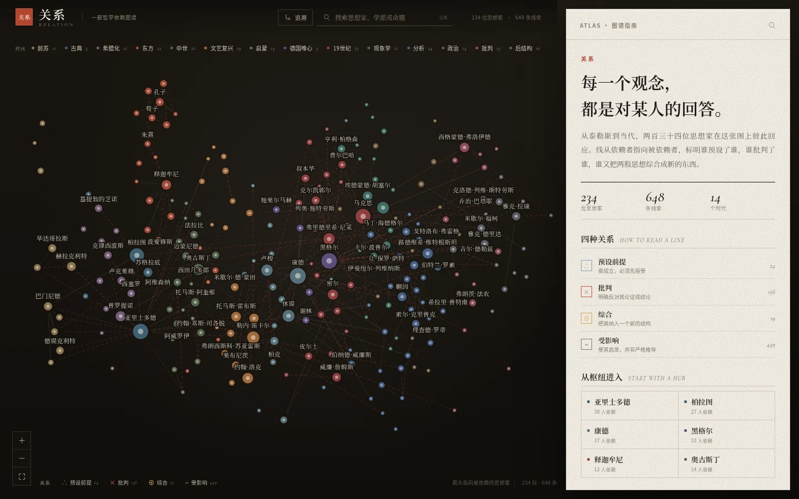
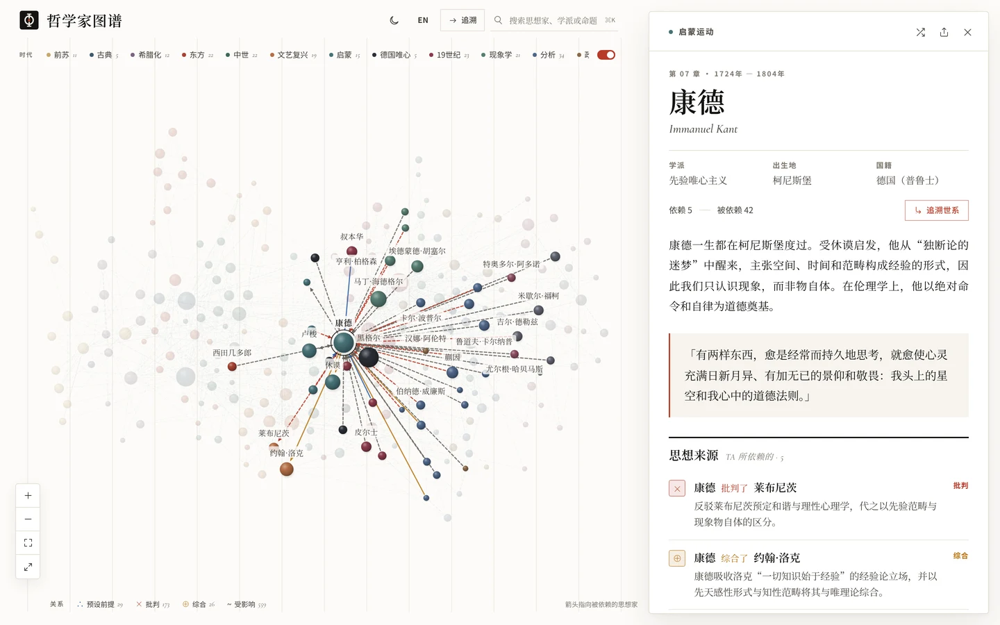
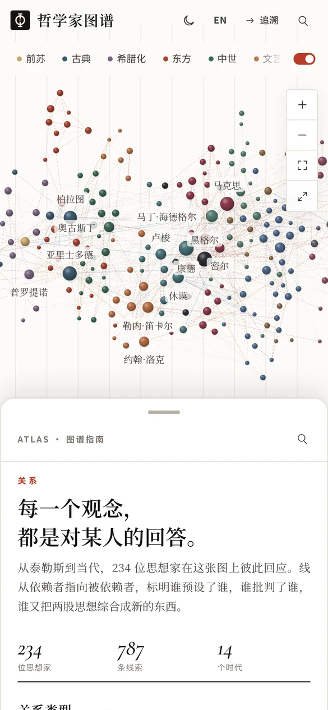

# 关系 · 哲学依赖图谱

> 每一个观念，都是对某人的回答。



一个可以沿着读的哲学依赖图谱。它把 `data.zh.js` 中的 234 位思想家组织成一张有方向的网络，并用四种关系说明他们之间的思想债务：

- **预设前提**：A 要成立，必须先接受 B 的某个区分或主张。
- **批判**：A 明确反对 B 的论证或结论。
- **综合**：A 把 B 的问题或立场纳入一个新的结构。
- **受影响**：A 受 B 启发，属于较宽的历史依赖，并非严格推导。

当前收录 234 位思想家、648 条关系，覆盖前苏格拉底到当代，以及中国、印度、日本、伊斯兰、犹太、基督教与非洲、拉美等传统。

## 怎么用

- **图谱**：拖动节点，滚轮或双指缩放。悬停查看人物摘要，点击打开档案。
- **档案**：先读「思想来源」和「思想去向」，理由就写在每条关系下面。
- **追溯世系**：选择两端，最短依赖链会高亮，并按顺序解释每一跳。
- **筛选**：顶部按时代，底部按关系类型。隐藏「受影响」后，剩下的批判与综合会显出一条更清晰的论争骨架。
- **搜索**：`⌘K` 或 `Ctrl K`，也可以直接按 `/`。
- **分享**：选中人物后地址栏会变成 `#/kant` 这样的可分享链接。





## 关系方向

每条边从**依赖者**指向**被依赖者**。箭头指向被依赖的思想家，而不是时间上的后来者。因此可能出现一位较早的思想家依赖一位较年轻的同时代人的情况。

读法：

- `毕达哥拉斯 → 泰勒斯`，读作「毕达哥拉斯受泰勒斯影响」。
- `康德 → 休谟`，读作「康德综合了休谟」。
- `海德格尔 → 尼采`，读作「海德格尔受尼采影响」，尽管海德格尔也在批判尼采。

界面中的每条关系都会写成完整句子，不让读者自己猜箭头。

## 数据

原始人物数据来自 `data.zh.js`，不改动。关系数据在 `data/relations.draft/`，按传统分成六组 JSON。构建脚本把它们合并、去重、校验，然后生成 `src/lib/data/graph.json`。

```bash
npm run data
```

校验内容：ID 存在、无自环、无重复有向边、关系类型合法、理由至少 12 个汉字、没有孤立节点、没有不可能的年代方向。

关系集是经过整理与审校的，不是自动抽取，也不是完备的哲学史。机器起草的初稿曾由三组独立审校逐条检查，修正了关系类型与方向错误，例如斯宾诺莎对迈蒙尼德、苏亚雷斯对阿奎那、商羯罗对龙树。仍会存在争议性判断，尤其是跨传统影响。生卒年多为约数，界面保留原始中文表述。

## 开发

需要 Node 20 以上。`npm run verify` 默认调用系统 Chromium，也可以用 `CHROMIUM_PATH` 指定其他可执行文件。

```bash
npm install
npm run dev       # http://localhost:5173
npm run check     # Svelte + TypeScript 类型检查
npm run verify    # Playwright 端到端验收，24 项断言
npm run build     # 重新生成数据并打包到 dist/
```

Rust 校验器读取打包后的图谱，做一层独立的类型化检查：

```bash
npm run graph:check
```

需要 Rust 工具链。它会输出关系类型分布、弱连通分量、被依赖最多的人物和时代统计。

## 结构

```
data.zh.js                    原始人物数据
data/relations.draft/         人工整理的关系源文件
scripts/build-graph.mjs       合并、校验、生成 graph.json
scripts/verify.mjs            浏览器端验收脚本
src/lib/graph/model.ts        图谱类型、索引、检索、最短路径
src/lib/state.svelte.ts       选择、筛选、追溯的状态机
src/lib/components/           Svelte 组件与 SVG 图谱
engine/src/main.rs            Rust 图谱校验器
src/lib/data/graph.json       生成物，构建时写入
```

## 实现说明

- Svelte 5 runes，TypeScript，Vite，静态部署，无后端。
- 图谱用 SVG 绘制，`d3-force` 做一次性布局，节点坐标确定且可复现。
- 标签在屏幕空间做碰撞规避，缩放时保持字号，不会缩成不可读的点。
- 关系类型与颜色集中在一个注册表里，句子语法也由同一个组件负责，避免图例、档案和追溯页各写一套。
- 移动端把档案做成底部纸张卡片，图谱保留在卡片上方；关系类型筛选放在首屏指南里。
- 支持 `prefers-reduced-motion`，键盘搜索与节点选择有可见焦点。

## 已知限制

- 关系不是全量哲学史，只收录能说清具体理由的边。
- 跨传统影响常带争议，界面会尽量在理由里标明「传统称」「经中介」或「后世阐释」。
- 没有账户、收藏或后端同步。阅读状态只保留在当前页面。
